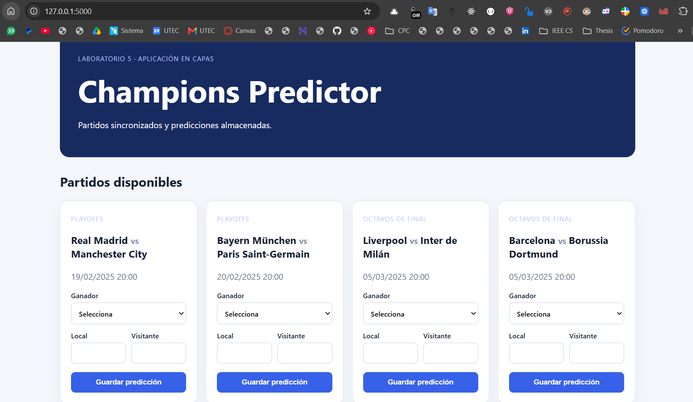
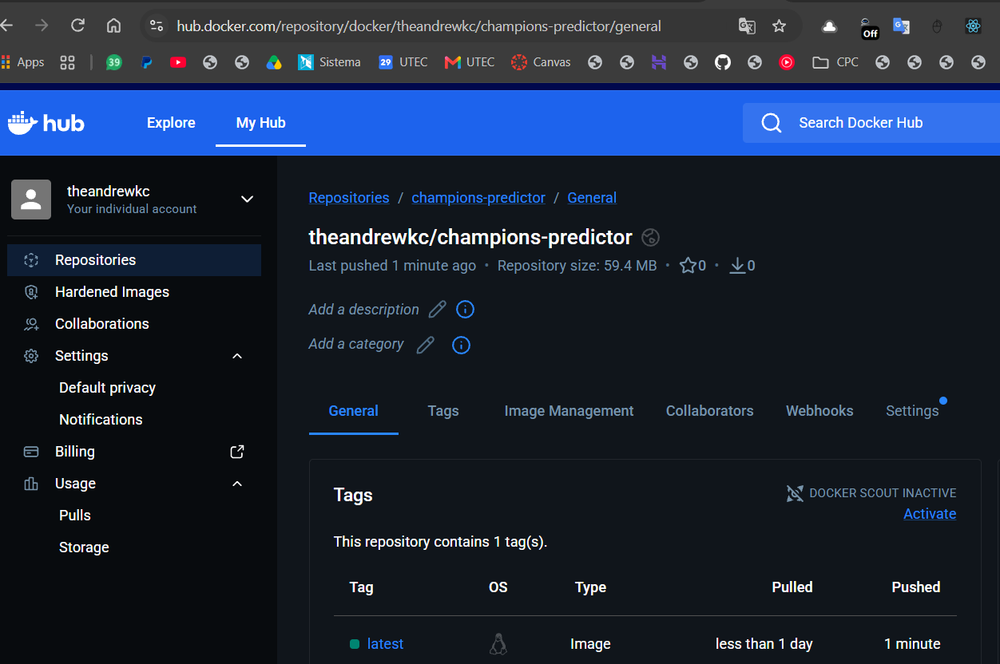
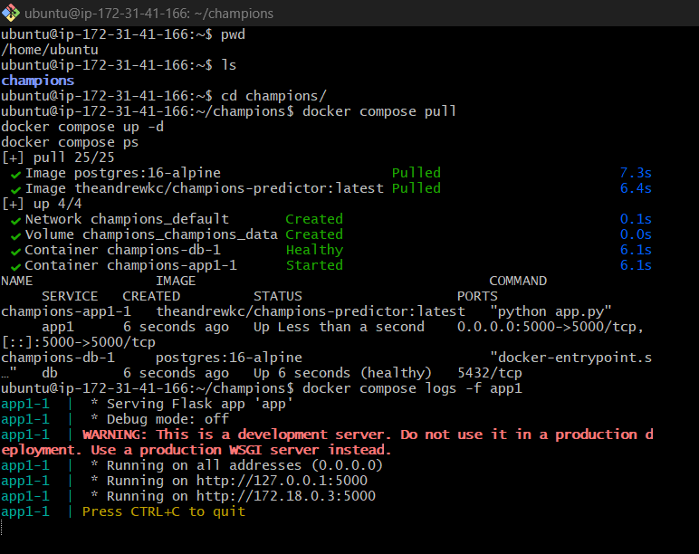
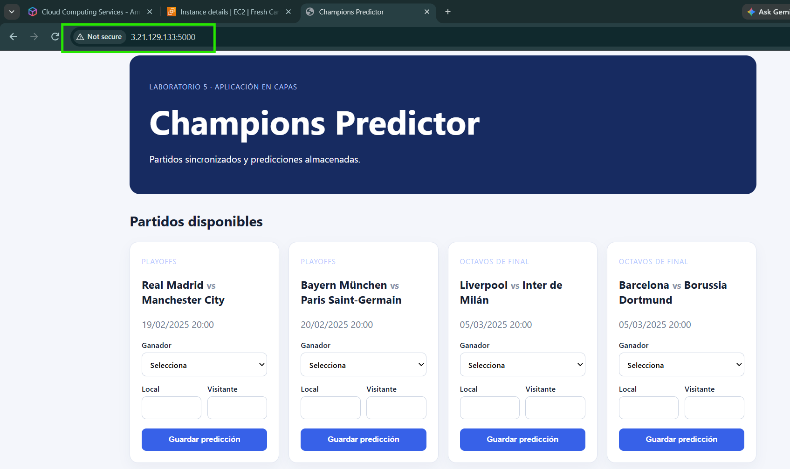

# App1 — Champions Predictor

> **Documentación final de despliegue y evidencias**

Esta sección documenta el despliegue realizado de la solución: publicación de la imagen en Docker Hub, ejecución de los servicios en AWS EC2, persistencia de PostgreSQL y acceso público a la aplicación. Las capturas utilizadas están almacenadas en la carpeta [`evidence/`](evidence/).

Aplicación web para la gestión de partidos y predicciones de la Champions League. La solución implementa la pregunta 1 del laboratorio y está organizada en tres capas:

```text
Navegador / API HTTP
        ↓
Presentación: presentation/routes.py + templates/
        ↓
Lógica de negocio: business/services.py
        ↓
Acceso a datos: data/repositories.py + data/models.py
        ↓
PostgreSQL persistente
```

## Funcionalidades implementadas

- Sincronización inicial de partidos desde un proveedor simulado.
- Almacenamiento de partidos en una base de datos relacional.
- Listado web y API de partidos.
- Registro de predicciones con ganador o empate y marcador estimado.
- Validación de coherencia entre ganador y marcador.
- Consulta web y API de todas las predicciones.

Endpoints disponibles:

```text
GET  /api/matches
POST /api/predictions
GET  /api/predictions
```

Ejemplo para crear una predicción:

```json
{
  "match_id": 1,
  "winner": "Empate",
  "home_score": 1,
  "away_score": 1
}
```

## Ejecución local

```powershell
cd app1
python -m venv .venv
.\.venv\Scripts\Activate.ps1
pip install -r requirements.txt
python app.py
```

Abrir http://localhost:5000.

## Despliegue con Docker

La configuración completa se encuentra en [docker-compose.yml](../docker-compose.yml). El Compose ejecuta dos servicios:

| Servicio | Imagen | Función |
|---|---|---|
| app1 | theandrewkc/champions-predictor:latest | Aplicación Flask en el puerto 5000 |
| db | postgres:16-alpine | Base de datos PostgreSQL |

La aplicación utiliza las siguientes variables:

```env
POSTGRES_PASSWORD=una-clave-segura
SECRET_KEY=un-secreto-de-flask
```

El archivo .env se crea a partir de [.env.example](../.env.example) y no debe publicarse en el repositorio.

Para ejecutar localmente los contenedores:

```powershell
Copy-Item .env.example .env
docker compose pull
docker compose up -d
docker compose ps
```

La persistencia de PostgreSQL está configurada mediante el volumen Docker champions_data, montado en /var/lib/postgresql/data.

## Publicación de la imagen

La imagen de la aplicación fue publicada en Docker Hub con el repositorio:

```text
theandrewkc/champions-predictor:latest
```

Comandos utilizados:

```powershell
docker login
docker tag lab5-sd-app1:latest theandrewkc/champions-predictor:latest
docker push theandrewkc/champions-predictor:latest
```

La evidencia de publicación se encuentra en [evidence/02-dockerhub-image.png](evidence/02-dockerhub-image.png).

## Despliegue en AWS EC2

La aplicación fue desplegada en una instancia EC2 con Ubuntu. La instancia utiliza Docker Engine y Docker Compose Plugin.

### 1. Configuración de la instancia

Se creó una instancia EC2 Ubuntu y se configuró el Security Group para permitir:

- TCP 22 para conexión SSH.
- TCP 5000 para acceder a la aplicación web.

### 2. Copiar la configuración al servidor

Desde PowerShell local se copiaron el Compose y las variables de entorno:

```powershell
$IP="IP_PUBLICA_EC2"
$KEY="C:\ruta\mi-clave.pem"

ssh -i $KEY ubuntu@$IP "mkdir -p /home/ubuntu/champions"
scp -i $KEY docker-compose.yml .env ubuntu@$IP:/home/ubuntu/champions/
```

### 3. Levantar los servicios en EC2

Después de conectarse por SSH:

```bash
cd ~/champions
docker compose pull
docker compose up -d
docker compose ps
docker compose logs -f app1
```

El resultado observado confirmó:

- Imagen de Docker Hub descargada correctamente.
- Imagen de PostgreSQL descargada correctamente.
- Volumen champions_champions_data creado.
- Contenedor champions-db-1 en estado healthy.
- Contenedor champions-app1-1 iniciado y exponiendo 0.0.0.0:5000->5000/tcp.

### 4. Acceso a la aplicación

La aplicación quedó accesible mediante la IP pública observada durante el despliegue:

```text
http://3.21.129.133:5000
```

La IP pública puede cambiar si la instancia se reinicia; para un entorno permanente se recomienda asociar una Elastic IP.

## Evidencias del despliegue

### Interfaz funcionando localmente

La primera evidencia muestra la interfaz de Champions Predictor en 127.0.0.1:5000, con los cuatro partidos cargados y formularios para registrar predicciones.



### Imagen publicada en Docker Hub

La segunda evidencia muestra el repositorio theandrewkc/champions-predictor en Docker Hub y la etiqueta latest publicada.



### Contenedores funcionando en AWS EC2

La tercera evidencia muestra la ejecución de docker compose pull, docker compose up -d, docker compose ps y los logs de la aplicación en la instancia EC2. Se observan PostgreSQL saludable y la aplicación iniciada.



### Aplicación accesible desde Internet

La cuarta evidencia muestra la aplicación funcionando desde la IP pública de EC2: 3.21.129.133:5000.



## Detener y revisar el despliegue

```bash
docker compose ps
docker compose logs --tail=100 app1
docker compose down
```

docker compose down detiene y elimina los contenedores, pero conserva los datos de PostgreSQL en el volumen Docker champions_data.
