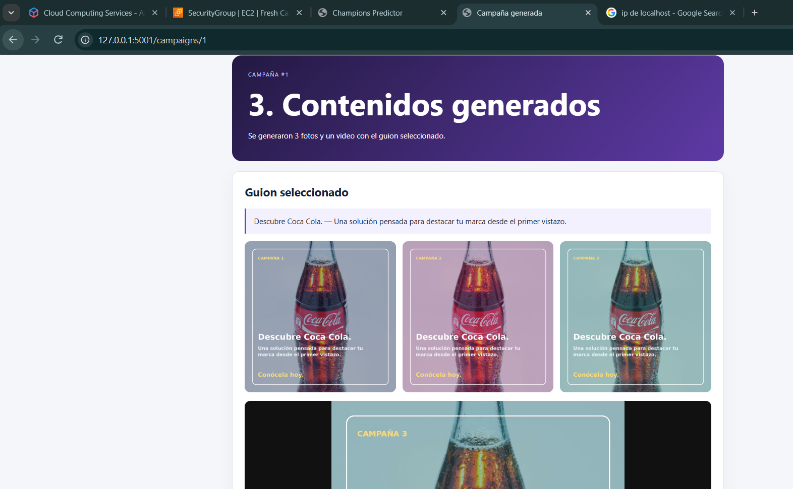
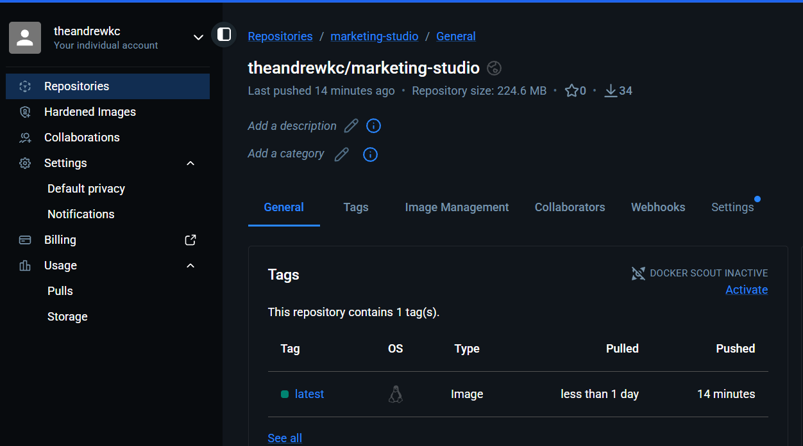
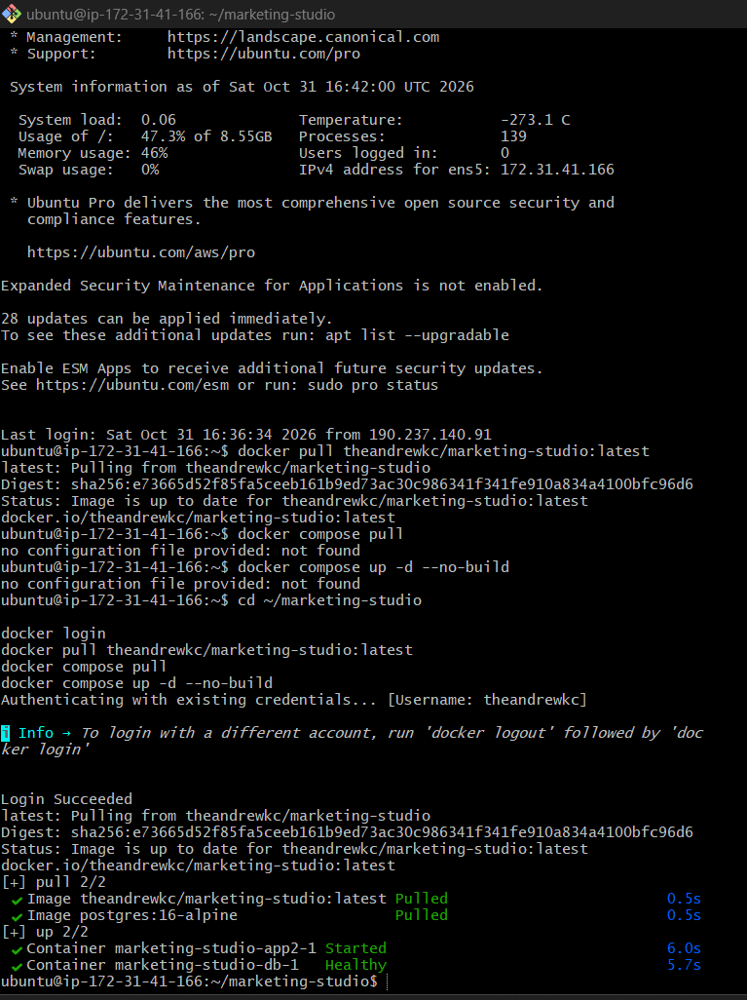
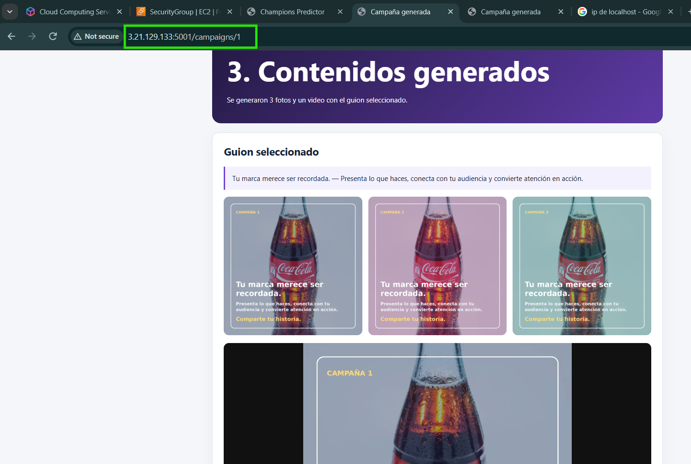

# App2 — Marketing Studio

## Descripción

Aplicación web de marketing para empresas. Recibe una foto, propone tres guiones, permite seleccionar uno, genera tres creativos visuales y un video MP4, y permite desplegar la campaña hacia Instagram o TikTok.

El flujo implementado es:

1. Recibir una foto JPG, PNG o WEBP.
2. Proponer tres guiones de marketing.
3. Seleccionar uno de los guiones.
4. Generar tres imágenes promocionales y un video MP4.
5. Seleccionar Instagram o TikTok y registrar la publicación.

La generación de imágenes usa Pillow y la generación del video usa FFmpeg. La publicación social está implementada en modo simulado mediante SOCIAL_MODE, porque una publicación real requiere credenciales y permisos de las APIs oficiales de Instagram o TikTok.

## Arquitectura

```text
Navegador
   ↓
Presentación: presentation/routes.py + templates/
   ↓
Lógica de negocio: business/services.py
   ↓
Acceso a datos: data/repositories.py + data/models.py
   ↓
PostgreSQL + volúmenes multimedia
```

## Funcionalidades

- Carga y validación de imágenes.
- Generación de tres propuestas de guion.
- Selección de guion y red social.
- Generación de tres variantes visuales.
- Generación de video MP4.
- Persistencia de campañas y activos.
- Publicación simulada con estado published_simulated.
- API de consulta de campañas:

```text
GET /api/campaigns/{id}
```

## Docker Compose

La solución está definida en [docker-compose.yml](docker-compose.yml) y contiene:

| Servicio | Imagen | Función |
|---|---|---|
| app2 | theandrewkc/marketing-studio:latest | Aplicación Flask en el puerto 5001 |
| db | postgres:16-alpine | Base de datos PostgreSQL |

Volúmenes:

- app2_storage: fotos, imágenes y videos generados.
- app2_db_data: datos persistentes de PostgreSQL.

## Variables de entorno

Crear el archivo .env a partir de [.env.example](.env.example):

```env
POSTGRES_PASSWORD=una-clave-segura
SECRET_KEY=un-secreto-de-flask
SOCIAL_MODE=simulated
```

No publicar .env ni claves privadas en GitHub.

## Ejecución local

Desde la carpeta app2:

```powershell
cd app2
Copy-Item .env.example .env
docker compose up --build -d
docker compose ps
```

Abrir:

```text
http://localhost:5001
```

Para detener la solución:

```powershell
docker compose down
```

## Publicación en Docker Hub

La imagen fue publicada en Docker Hub:

```text
theandrewkc/marketing-studio:latest
```

Repositorio:

[Docker Hub — marketing-studio](https://hub.docker.com/r/theandrewkc/marketing-studio)

Comandos utilizados:

```powershell
cd app2
docker compose build app2
docker login
docker tag marketing-studio:latest theandrewkc/marketing-studio:latest
docker push theandrewkc/marketing-studio:latest
```

## Despliegue en AWS EC2

La aplicación se desplegó en una instancia EC2 con Ubuntu y Docker Compose.

### 1. Copiar la configuración

Desde PowerShell local:

```powershell
$IP="IP_PUBLICA_EC2"
$KEY="C:\ruta\mi-clave.pem"

ssh -i $KEY ubuntu@$IP "mkdir -p /home/ubuntu/marketing-studio"
scp -i $KEY app2/docker-compose.yml app2/.env ubuntu@$IP:/home/ubuntu/marketing-studio/
```

### 2. Descargar la imagen en EC2

Conectarse al servidor:

```powershell
ssh -i $KEY ubuntu@$IP
```

Ejecutar en EC2:

```bash
cd ~/marketing-studio
docker login
docker pull theandrewkc/marketing-studio:latest
docker compose pull
docker compose up -d --no-build
docker compose ps
```

El parámetro --no-build permite utilizar la imagen publicada en Docker Hub sin reconstruirla en EC2.

### 3. Resultado del despliegue

La evidencia de consola confirma:

- Imagen theandrewkc/marketing-studio:latest descargada.
- Imagen postgres:16-alpine descargada.
- Contenedor marketing-studio-app2-1 iniciado.
- Contenedor marketing-studio-db-1 en estado healthy.
- Aplicación ejecutándose en el puerto 5001.

### 4. Acceso público

Durante la evidencia se accedió a:

```text
http://3.21.129.133:5001/campaigns/1
```

La IP pública puede cambiar si la instancia se reinicia. Para un despliegue permanente se recomienda asociar una Elastic IP y publicar la aplicación mediante HTTPS.

El Security Group de AWS debe permitir:

- TCP 22 para SSH, idealmente solo desde la IP del administrador.
- TCP 5001 para acceder a la aplicación durante la demostración.

## Evidencias

### Aplicación local con contenidos generados

La evidencia muestra una campaña creada localmente con el guion seleccionado, tres imágenes generadas y el video disponible:



### Imagen publicada en Docker Hub

La evidencia muestra el repositorio theandrewkc/marketing-studio con la etiqueta latest:



### Contenedores funcionando en AWS EC2

La evidencia muestra la descarga de la imagen, la ejecución de Docker Compose y los contenedores de App2 y PostgreSQL iniciados correctamente:



### Aplicación accesible desde Internet

La evidencia muestra App2 funcionando desde la IP pública de AWS EC2:



## Comandos de revisión

```bash
docker compose ps
docker compose logs --tail=100 app2
docker compose logs --tail=100 db
```

docker compose down detiene y elimina los contenedores, pero conserva los datos en app2_storage y app2_db_data.
